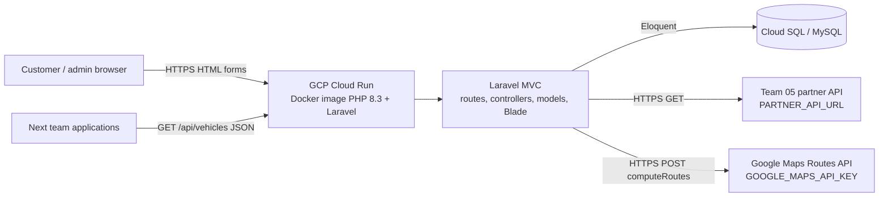
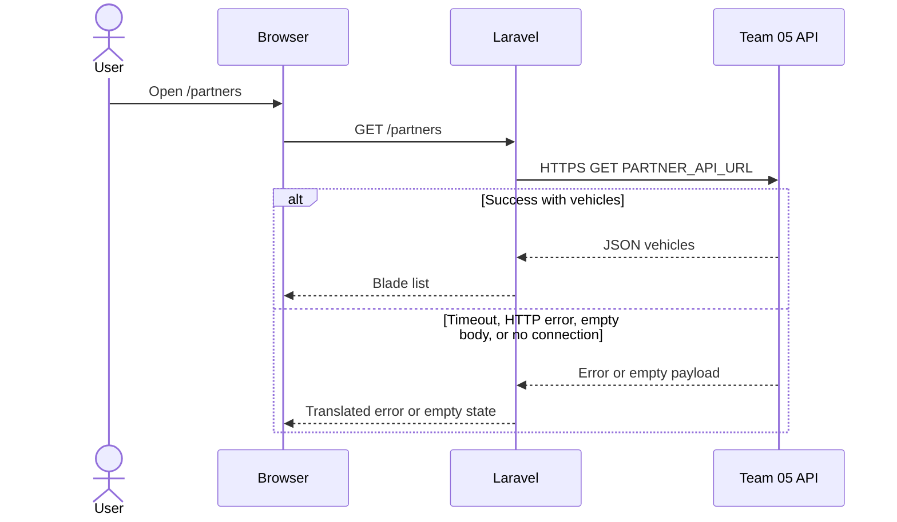
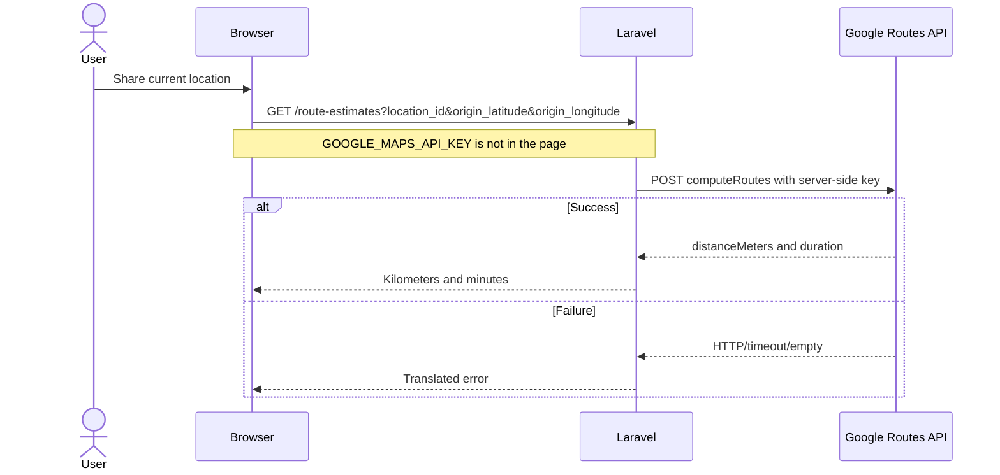

# Safety Rental architecture

Author: Alejandro Correa Marin  
Date: 2026-11-09  
Description: Inbound and outbound communication diagram for the Safety Rental Laravel application, including Docker and GCP deployment.

This document covers EPIC-04 / US-30. The visual diagram is also stored as [`architecture.svg`](architecture.svg).

## 1. Runtime overview

Safety Rental is a Laravel 13 MVC application. Authenticated customers and administrators use Blade views. Other course teams consume a public JSON catalog. Safety Rental consumes two external HTTP APIs from the server: the preceding team fleet API and the Google Maps Routes API.



## 2. Inbound communications

| Source | Protocol | Entry point | Auth | Response |
| --- | --- | --- | --- | --- |
| Customer browser | HTTPS | `/catalog`, `/partners`, `/route-estimates`, reservations | Session cookie, verified user | Blade HTML |
| Administrator browser | HTTPS | `/admin/*` | Session cookie, admin role | Blade HTML |
| Next team / allies | HTTPS | `GET /api/vehicles` and `GET /api/vehicles/{id}` | Public | JSON catalog of available vehicles |

The public vehicle API is documented in the root `README.md` section 15. It returns brand, model, category, location, daily rate, availability, and a detail URL. Deactivated vehicles are excluded.

## 3. Outbound communications

| Destination | Configured by | Helper | Failure handling |
| --- | --- | --- | --- |
| Preceding team JSON API | `PARTNER_API_URL`, optional `PARTNER_API_TOKEN` | `App\Helpers\PartnerFleetHelper` | Translated messages for missing config, connection errors, timeouts, HTTP errors, empty payloads, and invalid JSON |
| Google Maps Routes API | `GOOGLE_MAPS_API_KEY` | `App\Helpers\GoogleRoutesHelper` | Same error families; the API key never reaches Blade or JavaScript |
| MySQL | `DB_*` | Eloquent models | Standard Laravel database exceptions |

A local JSON fixture is not used in place of the partner HTTP call. Until team 05 publishes its GCP URL, `PARTNER_API_URL` can point to this application's own `/api/vehicles` endpoint so the HTTP client is still exercised.

## 4. Internal MVC flow

1. `routes/web.php` concatenates named routes onto path variables and points them at controllers inside `Admin`, `User`, or `Authentication`.
2. Form requests validate input. Controllers do not call `$request->validate()`.
3. Controllers load Eloquent models through eager loading, use getters, fill `$viewData`, and return a `View`, `RedirectResponse`, or `JsonResponse`.
4. External HTTP work lives in helper classes, not in Service classes, matching the project programming rules.
5. Blade views render `$viewData` and never receive the Google Maps key.

## 5. Docker and GCP

The production unit of deployment is the Docker image defined in the repository `Dockerfile`.

Suggested GCP layout:

1. Build the image in Cloud Build from the `Dockerfile`.
2. Push it to Artifact Registry.
3. Run it on Cloud Run with `--allow-unauthenticated` only if the public JSON API must stay reachable without IAM; otherwise place an HTTPS Load Balancer in front.
4. Store MySQL on Cloud SQL and inject `DB_*` through Secret Manager.
5. Inject `PARTNER_API_URL`, `PARTNER_API_TOKEN`, and `GOOGLE_MAPS_API_KEY` as Cloud Run secrets. Do not bake secrets into the image.
6. Map a custom HTTPS domain to Cloud Run so other teams can consume `https://<host>/api/vehicles`.

Local Docker check:

```bash
docker build -t safety-rental .
docker run --rm -p 8000:8000 --env-file .env safety-rental
```

Cloud Run still requires the architect to provision the GCP project, the Cloud SQL instance, and the public URL. This repository provides the application, the image, and this diagram so that deployment can be completed without changing application code.

## 6. Sequence: partner fleet page



## 7. Sequence: Google route estimate



## 8. Environment variables used by integrations

```dotenv
PARTNER_API_URL=
PARTNER_API_TOKEN=
PARTNER_API_TIMEOUT=8
GOOGLE_MAPS_API_KEY=
GOOGLE_ROUTES_API_URL=https://routes.googleapis.com/directions/v2:computeRoutes
GOOGLE_ROUTES_TIMEOUT=8
```
